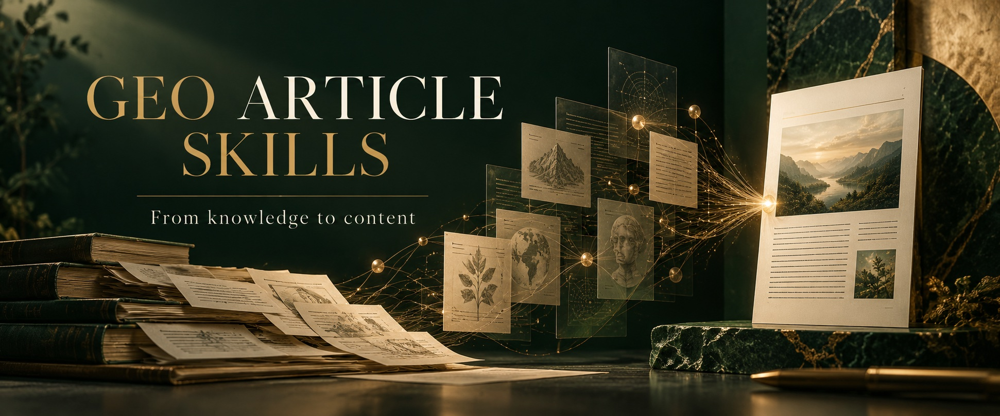
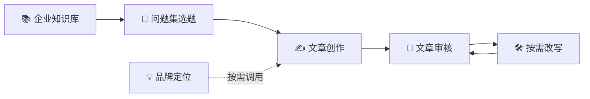

<p align="center">
  
</p>

<p align="center">
  <strong>从品牌知识，到一篇有依据、好阅读、便于 AI 理解的文章。</strong><br>
  为内容创作者和品牌团队准备的六个 Codex Skills。
</p>

<p align="center">
  <a href="#-快速开始">快速开始</a> ·
  <a href="#-六个技能">六个技能</a> ·
  <a href="#-工作流程">使用过程</a> ·
  <a href="#-常见问题">常见问题</a>
</p>

---

你可以从企业官网、产品资料和真实业务信息开始，把用户的问题变成选题，再写成文章、核对事实并按意见修改。每个阶段都有独立成果，方便检查，也方便从满意的版本继续。

| 📚 从真实资料出发 | 🎯 围绕用户问题 | 🔎 每一步都可检查 |
| --- | --- | --- |
| 保留企业信息、来源和适用范围 | 用你的问题集设计选题与文章 | 保存知识、简报、文章和审核版本 |

## ✨ 适合什么场景？

- **品牌内容建设**：把产品、服务、案例和业务边界整理为可复用的资料。
- **回答客户问题**：把一个或一组真实问题转成选题、写作简报和文章。
- **检查已有文章**：对照企业知识核实关键事实，找出证据不足和表达问题。
- **改写与复审**：保留可靠事实，从已有版本修改，再检查问题是否解决。

文章遵循经验、专业、权威和可信等内容质量原则，也关注时效、地域、场景和可验证性。结构按实际内容选择，避免为了形式硬凑案例、表格或 FAQ。

## 🧭 工作流程



> 💬 **你可以在每个阶段停下来检查。** 知识库经你确认后生效；选题地图、写作简报、文章与审核报告分别交付。你也可以明确要求连续完成多个阶段，遇到尚需确认的事实或选择时再停下。

## 🧩 六个技能

| 技能 | 适合什么时候用 | 主要产出 |
| --- | --- | --- |
| 📚 [`brand-knowledge-base`](skills/brand-knowledge-base/SKILL.md) | 整理企业官网、文件和业务资料 | 来源清单、知识草稿、已确认版本 |
| 💡 [`brand-positioning`](skills/brand-positioning/SKILL.md) | 梳理品牌是谁、为谁服务 | 一句话定位、简介、依据与缺口 |
| 🎯 [`brand-content-topics`](skills/brand-content-topics/SKILL.md) | 根据用户问题设计内容 | 问题覆盖地图、单篇写作简报 |
| ✍️ [`brand-content-write`](skills/brand-content-write/SKILL.md) | 将已选问题写成文章 | 文章、引用和证据对照表 |
| 🔎 [`brand-content-audit`](skills/brand-content-audit/SKILL.md) | 核对文章事实与内容质量 | 审核建议、分级问题、复审结果 |
| 🛠️ [`brand-content-rewrite`](skills/brand-content-rewrite/SKILL.md) | 按要求或审核意见改写 | 修改稿、变更说明、更新证据 |

## 🚀 快速开始

### 1. 安装到 Codex

需要 **Git** 和一个可运行 `sh` 的终端。克隆仓库后运行安装脚本：

```sh
git clone https://github.com/Xx-otaku/GEO-Article-Skills.git
cd GEO-Article-Skills
./install.sh
```

脚本将六个技能一起复制到 `${CODEX_HOME:-$HOME/.codex}/skills/`，以保留它们之间的共享规则。如果目标位置已经存在任何同名技能，脚本会停止并列出冲突，不会覆盖已有目录。

你也可以指定其他安装位置：

```sh
./install.sh --destination /path/to/skills
```

这里的 `/path/to/skills` 请替换为实际的技能目录。安装后，在下一次对话中使用对应技能名称。

### 2. 准备企业资料

可以提供品牌官网、本地资料文件夹，或在聊天中补充信息。资料可以逐步完善；知识库会记录读取情况、来源和待确认事项。

在 Codex 中可以这样开始：

```text
使用 $brand-knowledge-base 整理我的企业资料。
资料来自我提供的官网和本地文件夹，请先给我接收清单与待确认项。
```

检查并确认知识库中的企业事实和公开范围后，就能为具体问题准备文章。**只需本篇相关事实就绪，其他资料缺口可以继续保留。**

### 3. 从一个真实问题开始

```text
使用 $brand-content-topics，根据我的问题集生成选题地图。
我选定文章后，再为它生成写作简报。
```

如果已经确定一个问题，也可以直接说明：

```text
根据已确认的企业知识库，围绕这个客户问题生成写作简报：
预算有限的自建房外墙，怎样选择仿石材料？
```

之后依次使用 `$brand-content-write` 创作、`$brand-content-audit` 审核；需要修改时使用 `$brand-content-rewrite`，再对新版本复审。

## 🗂️ 每个阶段会留下什么？

每阶段以 Markdown 保存独立成果，并记录品牌、版本、上游材料和使用的知识库版本。没有指定输出位置时，默认放在当前任务的 `outputs/brand-content/品牌ID/`。

```text
企业资料 → 来源清单 → 知识库待确认稿 → 已确认知识库
                                      ↓
问题集 → 选题地图 → 写作简报 → 文章 + 证据表
                                      ↓
                              审核 → 修改 → 复审
```

原始资料默认保留原位。文章正文面向读者；写作过程、待核事项和审核记录放在交付说明或证据表中，读者需要的价格条件与适用范围仍保留在正文。

## 💬 常见问题

<details>
<summary><strong>没有 50 个问题，也能使用吗？</strong></summary>
<br>
可以。一个问题或一组问题都可以；技能会保留原问题，并根据实际数量规划，不会为了凑数自动添加问题。
</details>

<details>
<summary><strong>企业资料只有官网，可以开始吗？</strong></summary>
<br>
可以先整理能够访问的官网内容。具体价格、型号、案例或服务范围若没有可靠依据，会列为待确认项，不会自行补造。
</details>

<details>
<summary><strong>需要每次手动切换技能吗？</strong></summary>
<br>
不一定。可以在同一段对话中说明下一步，让 Codex 根据任务使用对应技能。默认阶段交付后停下；如果你明确要求连续完成，仍需在企业事实确认等关键节点作出决定。
</details>

<details>
<summary><strong>用了这套技能，文章就一定会被 AI 引用吗？</strong></summary>
<br>
不能保证。它帮助你整理可核验的信息、写清条件和结构，并检查内容质量；实际抓取、收录和引用取决于具体平台及其他因素。
</details>

## 📁 仓库结构

```text
GEO-Article-Skills/
├── README.md
├── install.sh
├── assets/
│   └── hero.svg
└── skills/
    ├── brand-knowledge-base/
    ├── brand-positioning/
    ├── brand-content-topics/
    ├── brand-content-write/
    ├── brand-content-audit/
    └── brand-content-rewrite/
```

六个目录需要保持同级：创作、改写和审核会读取企业知识库技能中的共享流程与质量规则。本仓库保存的是工作方法；企业资料和文章成果由你在实际使用时提供并管理。

---

<p align="center">
  <strong>好内容，先回答人的问题。</strong><br>
  让事实有出处，让每一步都能继续。 🌱
</p>
